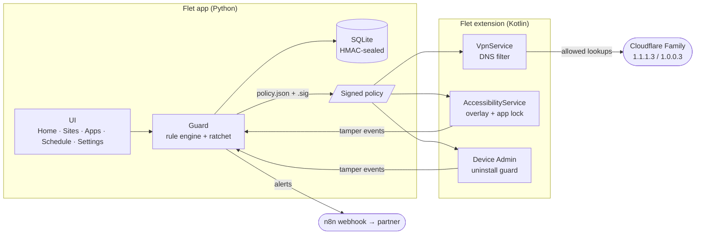

<div align="center">


# GuardPulse

**A completely free content blocker with accountability controls.**
Block sites and apps, filter adult content with Cloudflare Family DNS, and put someone you trust in charge of the off switch.


[Features](#-features) · [How it works](#-how-it-works) · [Roadmap](#-roadmap) · [Getting started](#-getting-started) · [Security model](#-security-model) · [FAQ](#-faq)

</div>

---

## ✨ Features

| | Feature | What it does |
|---|---|---|
| 🚫 | **Website blacklist** | Block any domain and all of its sub-domains. Paste a full link and GuardPulse works out the domain. |
| ✅ | **Website whitelist** | Always allow specific sites, even inside a blocked domain. The most specific rule wins. |
| 📱 | **App blocking** | Block whole apps, with one-tap presets for TikTok, Instagram, Snapchat, Reddit, X, Telegram and more. |
| 🎬 | **Short-video feeds** | Turn off YouTube Shorts, Instagram and Facebook Reels, and Snapchat Spotlight while keeping the rest of the app. |
| ⏰ | **Scheduled app lock** | Lock chosen apps during bedtime, study or work hours, including windows that run past midnight. |
| 🛡️ | **Cloudflare Family DNS** | Every app's DNS goes through `1.1.1.3` / `1.0.0.3`, which filter adult content and malware. |
| 🤝 | **Accountability partner** | Your partner's PIN is needed for anything that loosens protection. |
| 🔑 | **Remote unlock codes** | Away from your partner? They read you a one-time 6-digit code from their authenticator app. |
| 🚨 | **Tamper alerts** | Unlocks, wrong PINs, whitelisting and protection being switched off are queued for your partner. |
| 🧷 | **Uninstall protection** | GuardPulse can't be removed without the partner PIN. |
| 🔏 | **Sealed rules** | The rule set is signed with HMAC-SHA256, so editing the database outside the app is detected and reported. |

## 🧭 How it works

### The one-way ratchet

Making protection **stricter is always free**. Making it **looser always needs your partner**.

| Free, any time | Needs the partner PIN or code |
|---|---|
| Block a site or app | Whitelist a site |
| Add a schedule | Delete any block, app or whitelist entry |
| Resume a paused schedule | Pause or delete a schedule |
| Turn a protection **on** | Turn a protection **off** |
| Shorten the unlock window | Lengthen the unlock window |
| | Change the partner, PIN, authenticator or alert webhook |

An unlock lasts 1 to 30 minutes (5 by default) and is held in memory only, so restarting the app locks it again. Three wrong attempts trigger a back-off that starts at 30 seconds and doubles each time, up to an hour. The back-off survives restarts.

### Architecture



Flet handles the UI, data and rules. Android only exposes VPN, Accessibility and Device Admin to native code, so the enforcement services live in a Kotlin extension that reads the signed `policy.json` the Python side writes after every change.

## 🗺️ Roadmap

- [x] **Phase 1: Core app.** Flet 1.0.5 UI, SQLite with an HMAC seal, partner PIN (scrypt) and TOTP codes, the one-way ratchet, schedules, activity log, signed policy export, 25 unit tests
- [ ] **Phase 2: DNS filter.** Kotlin `VpnService` that intercepts DNS only: blacklisted names get no answer, everything else goes to Cloudflare Family
- [ ] **Phase 3: Security overlay.** `AccessibilityService` that reads browser URL bars, blocks apps and short-video feeds, applies schedule locks, and includes an installed-app picker
- [ ] **Phase 4: Uninstall protection.** Device Admin plus a PIN screen over the app's Settings, force-stop and uninstall pages
- [ ] **Phase 5: Partner alerts.** The alert outbox posts to an n8n webhook, which emails or WhatsApps the partner. Alerts are queued while the phone is offline.

## 🚀 Getting started

**Requirements:** Python 3.12, [uv](https://docs.astral.sh/uv/). Android builds also need JDK 17 and the Android SDK, which `flet build` installs on first run.

```bash
uv venv .venv --python 3.12
```

```bash
uv pip install --python .venv/Scripts/python.exe "flet[all]==1.0.5" "segno==1.6.6"
```

**Run on desktop** (hot reload):

```bash
cd src && ../.venv/Scripts/flet run main.py
```

**Run the tests:**

```bash
.venv/Scripts/python.exe -m unittest discover -s tests -v
```

**Build the Android APK:**

```bash
.venv/Scripts/flet build apk --split-per-abi
```

> Release APKs go out as GitHub releases, signed with the project keystore. Never publish a debug-signed build: Android rejects it as an update over a properly signed install.

### Project layout

```
src/
├── main.py                  # entry point
├── assets/icon.png          # launcher icon
└── guardpulse/
    ├── guard.py             # rule engine, ratchet, tamper seal, policy export
    ├── security.py          # scrypt PIN, RFC 6238 TOTP, HMAC seal
    ├── domains.py           # URL → domain normalising + matching
    ├── db.py                # SQLite schema + app-private storage
    ├── native.py            # bridge to the Kotlin services (stub until phase 2)
    └── ui/                  # Flet screens, onboarding, theme
tests/test_guard.py          # engine tests
```

## 🔐 Security model

| Concern | How GuardPulse handles it |
|---|---|
| **PIN storage** | Only a salted `scrypt` hash is stored (N=2¹⁴, r=8, p=1). The PIN itself is never written to disk. |
| **Brute force** | Three free attempts, then a back-off from 30 s up to 1 h. The counter is stored, so restarting the app doesn't reset it. |
| **Remote codes** | Standard RFC 6238 TOTP (6 digits, 30 s, ±1 step for clock drift). Each code works once. |
| **DB tampering** | Rules, apps, schedules, settings and partner credentials are sealed with HMAC-SHA256. A mismatch flags the app, queues an alert, and only the partner can clear the warning. |
| **Policy hand-off** | The `policy.json` file the native services read is signed with the same key. |
| **Data location** | App-private storage (`FLET_APP_STORAGE_DATA`), which other apps can't read without root. |

> **Why not an "encrypted SQLite"?** SQLCipher isn't available for Python on Android. The real risk is that someone *changes* the rules, not that they *read* them, so GuardPulse signs the data instead of encrypting it. The signing key moves into the Android Keystore in phase 2.

## ❓ FAQ

<details>
<summary><b>Is it really free?</b></summary>

Yes. No subscriptions, no paywalled features, no ads, and no accounts.
</details>

<details>
<summary><b>What about iPhone?</b></summary>

iOS only allows this kind of blocking through Apple's Screen Time and Network Extension APIs, which need special entitlements and Swift code. GuardPulse is Android-only.
</details>

<details>
<summary><b>Can it be bypassed?</b></summary>

No app that runs on the phone is unbreakable. Safe mode, a factory reset or ADB can get around any user-level blocker. GuardPulse's job is to make bypassing slow and **visible**: switching any protection off or tampering with the rules alerts your partner.
</details>

<details>
<summary><b>Why isn't it on the Play Store?</b></summary>

Google closely restricts apps that combine Accessibility and VPN permissions. Releasing on GitHub keeps every feature available with no policy review.
</details>

---

<div align="center">
<sub>Built with <a href="https://flet.dev">Flet</a> · DNS filtering by <a href="https://one.one.one.one/family/">Cloudflare 1.1.1.1 for Families</a></sub>
</div>
